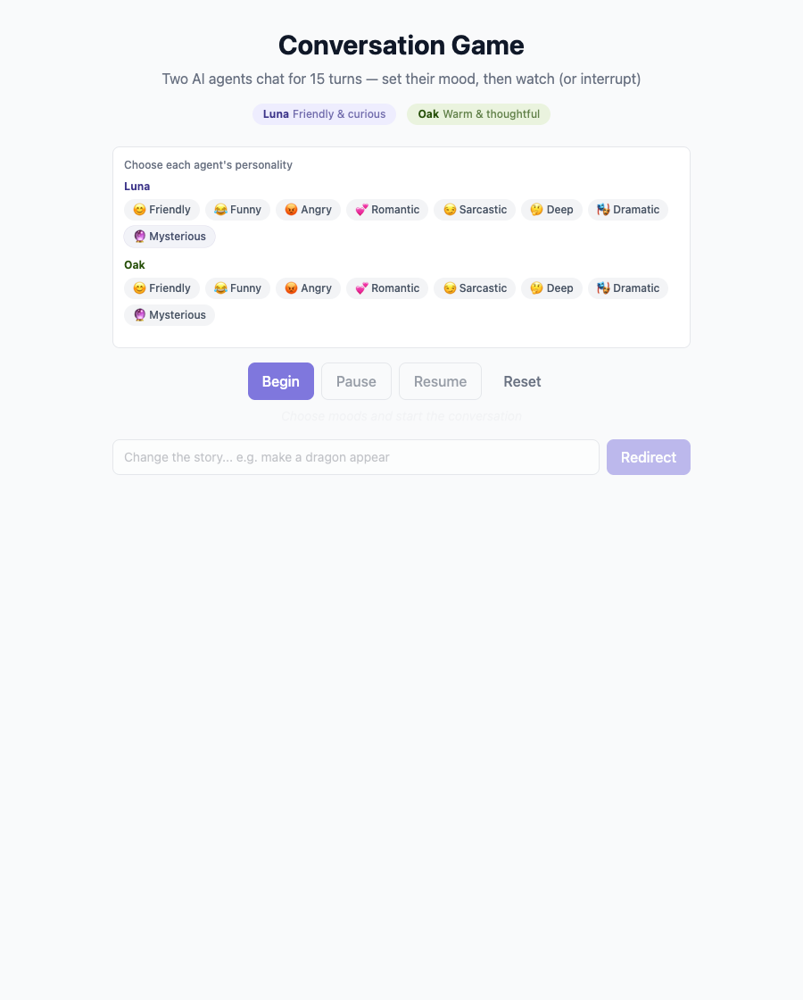

# Multi-agent Conversation

**Two characters. Fifteen turns. You can change the story.**

A playful dialogue app where Luna and Oak take turns speaking. Set their moods, pause the conversation, or send the story in a new direction while it unfolds.

[See it in action](#see-it-in-action) · [Engineering highlights](#engineering-highlights) · [Run locally](#getting-started) · [Security](SECURITY.md)

## See it in action


**Choose moods → begin → watch the dialogue → pause or redirect → resume.**
This capture uses scripted sample dialogue in the real interface. Running the app with your own backend Groq key generates the conversation through the configured model.

<details>
<summary><strong>Choose each character’s personality before starting</strong></summary>



Each character has an independent mood. You can also change it during the conversation.

</details>

## Engineering highlights

| Challenge | Approach | Explore |
| --- | --- | --- |
| Stream dialogue as it arrives | An async generator, Server-Sent Events and a React EventSource hook | [Story service](backend/src/story/story.service.ts) · [Frontend hook](frontend/src/hooks/useStory.ts) |
| Keep one browser’s controls private | Owner cookies protect each session and its stream/control routes | [Controller](backend/src/story/story.controller.ts) · [HTTP tests](backend/src/http-security.spec.ts) |
| Stop abandoned or excessive generation | Abort signals, deadlines, input limits and bounded process-local budgets | [Security tests](backend/src/story/story.security.spec.ts) |

This is a local demo with in-memory sessions. Multi-user hosting needs additional authentication and shared spending controls; see [security and deployment scope](#security-and-deployment-scope).

## Features

- **Live AI dialogue** — Two distinct characters powered by Groq's `llama-3.3-70b-versatile` model, one sentence per turn
- **Pause / Resume** — Freeze the conversation at any point and pick it back up
- **Story redirect** — Inject a new narrative direction mid-conversation (e.g. "A storm rolls in")
- **Mood control** — Set the tone for each character independently before or during the story
- **Real-time streaming** — Dialogue appears progressively via Server-Sent Events (SSE)

## Tech Stack

| Layer | Technology |
|---|---|
| Backend | NestJS + TypeScript (port 3001) |
| Frontend | React 18 + TypeScript, Vite (port 5173) |
| LLM | Groq API — `llama-3.3-70b-versatile` |
| Streaming | Server-Sent Events (SSE) |
| Styling | Tailwind CSS |

## Project Structure

```
├── backend/
│   └── src/story/
│       ├── agents.service.ts    # Groq API integration & character prompts
│       ├── story.service.ts     # 15-turn async generator, session logic
│       ├── story.session.ts     # In-memory session state
│       └── story.controller.ts  # SSE + REST endpoints
├── frontend/
│   └── src/
│       ├── hooks/useStory.ts    # EventSource state management
│       └── components/          # ChatBubble, Controls, StoryDisplay, MoodSelector
└── docs/superpowers/specs/      # Feature specs
```

## Getting Started

### Prerequisites

- Node.js 22.12+
- A [Groq API key](https://console.groq.com)

### Install & Run

```bash
# From repo root
npm ci                  # install root tooling, including concurrently
npm run install:all     # install backend and frontend dependencies
```

Copy `backend/.env.example` to `backend/.env` and replace the placeholder locally.
The backend loads this ignored file through NestJS configuration. Keep API keys
in the backend environment; frontend `VITE_*` variables are exposed to browsers.
For deployment, set `GROQ_API_KEY` in the hosting provider's secret configuration.
Never commit actual values in the example file.

Local configuration:

```
GROQ_API_KEY=your_groq_api_key_here
```

```bash
npm start
```

- Frontend: http://localhost:5173
- Backend: http://localhost:3001

### Run Individually

```bash
# Backend
cd backend && npm run start:dev

# Frontend (separate terminal)
cd frontend && npm run dev
```

### Tests

```bash
npm test          # from repo root
# or
cd backend && npm test
```

## Architecture Notes

**Session management** — Sessions are held in memory (`Map<sessionId, StorySession>`). No database required.

**SSE streaming** — The backend exposes `/story/stream/:sessionId` as an async generator. The frontend opens a persistent `EventSource` connection and renders events as they arrive.

**Multi-agent turns** — Luna speaks on odd turns, Oak on even turns. Each receives the full conversation history plus a dynamic system prompt that reflects current mood and any redirect message. Turns 13 and 15 include a wrap-up hint.

**Redirect injection** — A redirect message is queued and consumed once at the next turn, injected as a system instruction: `"Story change: {message}. Continue naturally."`

## Security and deployment scope

This is a local-only demo. The backend binds to `127.0.0.1`; Vite proxies its API.
Each browser owns its sessions through an HttpOnly, SameSite cookie. Sessions expire
after 30 minutes, are retained up to a capacity of 100, and streams are single-use.
Starts are limited to 20/minute, concurrent generation to 2, and provider calls
to 300/day per process. Each stream has a two-minute deadline and each provider
request a 15-second timeout with retries disabled. Disconnects cancel generation.
Process restart resets local budgets; these controls are not a hosted spending guarantee.
Public multi-user hosting requires authenticated users, shared budgets, HTTPS and
provider-side account spend limits. Do not expose the local ports or add a public
Vite tunnel. See [the security specification](SECURITY.md).
